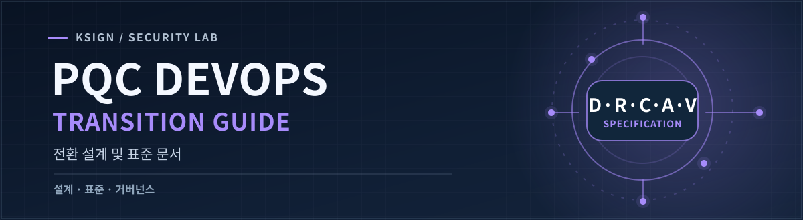
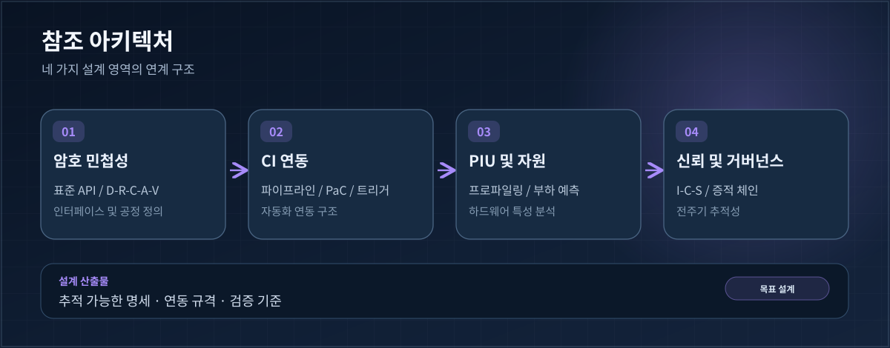

<p align="right">🌐 <a href="./README.md">English</a> · <strong>한국어</strong></p>



<p align="center">
  <a href="https://github.com/KSign-Security-Lab/pqc-devops-guide/issues"></a>
  <a href="https://github.com/KSign-Security-Lab/pqc-devops-core"></a>
  <a href="./LICENSE"></a>
</p>

**DevOps 기반 양자내성암호(PQC) 전환을 위한 설계·표준 문서 저장소입니다.** 목표 아키텍처, API 연동 규격, 전환 공정, 성능 평가 기준, 증적·거버넌스 모델을 정의합니다.

> **프로젝트 단계:** 아키텍처와 명세를 수립하는 단계입니다. 아래 항목은 **개발·작성 예정 산출물**이며, 이미 완성되거나 배포된 문서가 아닙니다.

<p align="center">
  <a href="#아키텍처">아키텍처</a> ·
  <a href="#설계-산출물">설계 산출물</a> ·
  <a href="#작업-흐름">작업 흐름</a> ·
  <a href="https://github.com/KSign-Security-Lab/pqc-devops-guide/issues">로드맵 ↗</a>
</p>

## 프로젝트 목적

PQC 전환은 암호 알고리즘 하나를 교체하는 작업만으로 끝나지 않습니다. 기존 애플리케이션의 암호 API와 새로운 구현체를 분리하고, CI 환경에서 전환 과정을 검증하며, 하드웨어별 자원 부담과 전주기 증적을 함께 다뤄야 합니다.

이 저장소인 **Guide**는 전환 과정에서 따라야 할 설계와 검증 기준을 정의합니다. 연관 저장소인 **[Core](https://github.com/KSign-Security-Lab/pqc-devops-core)**는 SDK, 전환 규칙, 코드 스니핏, 관련 데이터 모델의 구현을 담당합니다.

| 저장소 | 역할 | 주요 산출물 |
|:--|:--|:--|
| **[Guide](https://github.com/KSign-Security-Lab/pqc-devops-guide)** · 현재 저장소 | **무엇을 어떻게 검증할지** 정의 | API 명세, 공정 정의서, CI 아키텍처, 증적 프로토콜 |
| **[Core](https://github.com/KSign-Security-Lab/pqc-devops-core)** | **어떻게 구현할지** 구체화 | SDK 프로토타입, YAML/JSON 규칙, C/Java 스니핏, PIU 지식베이스 |

## 아키텍처



*현재 배포된 시스템이 아닌 설계 목표를 설명하는 개념도입니다.*

핵심 설계 영역은 네 가지입니다.

1. **Crypto-Agility** — 알고리즘 중립적인 API 시그니처, 레거시 암호 API와 SDC-API 간 매핑, D-R-C-A-V 전환 공정.
2. **CI 연동** — CI 파이프라인 아키텍처, 컨테이너 기반 실행 구조, Pipeline-as-Code(PaC), 웹훅 및 증분 분석 트리거.
3. **PIU 및 자원** — PQC 구현 단위(PIU)의 성능 프로파일링, 하드웨어별 부하·가용성 예측.
4. **신뢰 및 거버넌스** — Identity-Context-Status(I-C-S) 증적, 추적성 및 전주기 거버넌스 요구사항.

## 설계 산출물

아래 링크는 **산출물을 정의한 Issue**로 연결됩니다. 문서가 작성·공개되면 이 표에서 실제 문서로 연결할 예정입니다.

| 영역 | 작성할 산출물 | Issue |
|:--|:--|:--|
| 암호 민첩성 | 레거시-SDC API 매핑 및 알고리즘 중립 인터페이스 표준 사양서 | [#3](https://github.com/KSign-Security-Lab/pqc-devops-guide/issues/3) |
| 전환 공정 | D-R-C-A-V 단계, 상태 전이, 입출력 스키마 및 오류 처리 공정 정의서 | [#4](https://github.com/KSign-Security-Lab/pqc-devops-guide/issues/4) |
| CI 아키텍처 | CI 워크플로, 실행 환경, 시스템 연동 및 검증 과정 설계서 | [#5](https://github.com/KSign-Security-Lab/pqc-devops-guide/issues/5) |
| Pipeline-as-Code | PaC 스켈레톤, 웹훅 매핑, 증분 분석 필터 및 CI 도구 연동 규격 | [#6](https://github.com/KSign-Security-Lab/pqc-devops-guide/issues/6) |
| PIU 프로파일링 | 자원 점유량, 구현 오버헤드, 가용성 임계치, 하드웨어 프로파일 리포트 | [#7](https://github.com/KSign-Security-Lab/pqc-devops-guide/issues/7) |
| 부하 예측 | 하드웨어별 성능 가중치, 최대 자원 요구량, 프로파일링 기반 예측 명세 | [#8](https://github.com/KSign-Security-Lab/pqc-devops-guide/issues/8) |
| 증적 체이닝 | I-C-S 모델, 해시 기반 증적 연결, 인과관계 및 Trace-ID 추적성 설계 | [#10](https://github.com/KSign-Security-Lab/pqc-devops-guide/issues/10) |
| 거버넌스 | PQC 전환 전주기를 연계·관리하기 위한 표준 프레임워크 초안 | [#11](https://github.com/KSign-Security-Lab/pqc-devops-guide/issues/11) |

## 작업 흐름

```text
Issue / 요구사항
       ↓
아키텍처 및 인터페이스 제안
       ↓
명세 검토 및 Pull Request
       ↓
승인된 명세 ──────────────→ Core 구현 작업
       ↓                           ↓
검증 기준 ◀──────────── 테스트 및 프로파일링 증적
```

**기여 방법**

1. [설계 Issue](https://github.com/KSign-Security-Lab/pqc-devops-guide/issues)를 선택하고 범위와 작성할 산출물을 명확히 합니다.
2. 필요한 인터페이스, 입력·출력, 오류 처리, 검증 조건을 명세합니다.
3. 해당 Issue를 연결한 Pull Request를 생성해 검토받습니다.
4. 구현이 필요한 작업은 **[pqc-devops-core](https://github.com/KSign-Security-Lab/pqc-devops-core/issues)**에서 연계합니다.

현재 저장소에는 README와 기본 프로젝트 파일 외에 공개된 명세 문서나 실행 소프트웨어가 없습니다. 진행 현황은 Issue를 기준으로 확인해 주세요.

## 참고 자료

- [NIST Post-Quantum Cryptography 프로젝트](https://csrc.nist.gov/projects/post-quantum-cryptography/) — 외부 표준 참고 자료이며, 현재 프로젝트의 표준 준수·인증을 의미하지 않습니다.
- [Core 구현 저장소](https://github.com/KSign-Security-Lab/pqc-devops-core) · [Guide 작업 현황](https://github.com/KSign-Security-Lab/pqc-devops-guide/issues)

---

<sub>**KSign Security Lab** · <a href="./LICENSE">Apache License 2.0</a></sub>

