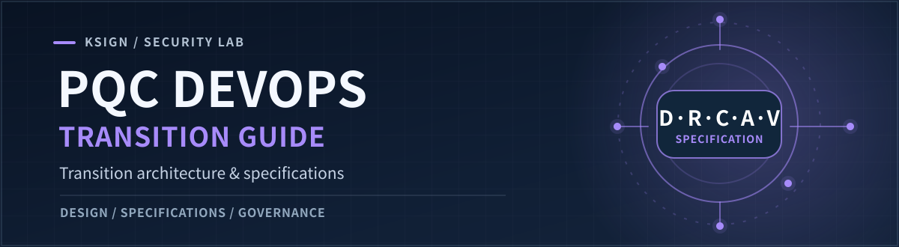
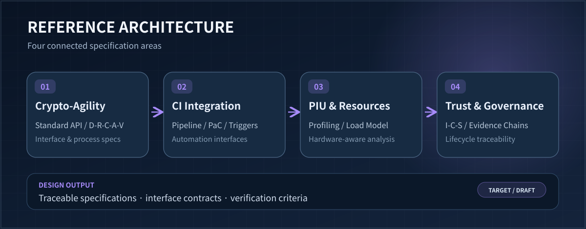

<p align="right">🌐 <strong>English</strong> · <a href="./README.ko.md">한국어</a></p>



<p align="center">
  <a href="https://github.com/KSign-Security-Lab/pqc-devops-guide/issues"></a>
  <a href="https://github.com/KSign-Security-Lab/pqc-devops-core"></a>
  <a href="./LICENSE"></a>
</p>

**The design and specification hub for DevOps-driven post-quantum cryptography (PQC) transition.** This repository defines the target architecture, interface contracts, transition process, performance criteria, and evidence model that the implementation should follow.

> **Project stage:** Specification and architecture design. The deliverables below are tracked work items, **not completed or released specifications**.

<p align="center">
  <a href="#architecture">Architecture</a> ·
  <a href="#specification-tracks">Specifications</a> ·
  <a href="#delivery-workflow">Workflow</a> ·
  <a href="https://github.com/KSign-Security-Lab/pqc-devops-guide/issues">Roadmap ↗</a>
</p>

## Why this project?

PQC transition is more than replacing one cryptographic primitive. It also changes how applications select crypto providers, how CI pipelines detect and validate migrations, how resource overhead is evaluated, and how decisions are made traceable across the software lifecycle.

The **Guide** captures the design and verification contracts. The companion **[Core](https://github.com/KSign-Security-Lab/pqc-devops-core)** repository develops the SDK, mapping templates, reusable snippets, and supporting data models.

| Repository | Responsibility | Main outputs |
|:--|:--|:--|
| **[Guide](https://github.com/KSign-Security-Lab/pqc-devops-guide)** · you are here | Specify **what must happen** and how it is verified | API definitions, process descriptions, CI architecture, evidence protocol |
| **[Core](https://github.com/KSign-Security-Lab/pqc-devops-core)** | Implement **how it works** | SDK prototype, YAML/JSON rules, C/Java snippets, PIU knowledge base |

## Architecture



*Conceptual reference architecture, not a diagram of an already deployed system.*

The design connects four concerns:

1. **Crypto-Agility** — Algorithm-neutral API signatures, mappings between legacy crypto calls and SDC APIs, and the D-R-C-A-V transition process.
2. **CI integration** — Pipeline architecture, container-based execution assumptions, Pipeline-as-Code (PaC) entry points, webhooks, and incremental analysis triggers.
3. **PIU & resources** — Profiling and load estimation for PQC Implementation Units (PIUs) across hardware environments.
4. **Trust & governance** — Identity-Context-Status (I-C-S) evidence, traceability, and requirements for lifecycle governance.

## Specification tracks

Each link below opens the **issue that defines the planned deliverable**; documentation will be linked here after it is published.

| Track | Planned deliverable | Tracking |
|:--|:--|:--|
| Crypto-Agility | Standard API specification for legacy-to-SDC mappings and algorithm-neutral interfaces | [#3](https://github.com/KSign-Security-Lab/pqc-devops-guide/issues/3) |
| Transition process | D-R-C-A-V stages, state transitions, input/output schemas, and failure handling | [#4](https://github.com/KSign-Security-Lab/pqc-devops-guide/issues/4) |
| CI architecture | CI workflow, execution environments, integration boundaries, and verification steps | [#5](https://github.com/KSign-Security-Lab/pqc-devops-guide/issues/5) |
| Pipeline-as-Code | PaC skeleton, Git webhook mappings, incremental-analysis filters, and CI tool interfaces | [#6](https://github.com/KSign-Security-Lab/pqc-devops-guide/issues/6) |
| PIU profiling | Baseline resource usage, implementation overhead, availability thresholds, hardware profiles | [#7](https://github.com/KSign-Security-Lab/pqc-devops-guide/issues/7) |
| Load prediction | Hardware-specific weights, peak-resource estimates, profiling-based prediction method | [#8](https://github.com/KSign-Security-Lab/pqc-devops-guide/issues/8) |
| Evidence chaining | I-C-S model, hash-linked evidence, causal relationships, and Trace-ID traceability | [#10](https://github.com/KSign-Security-Lab/pqc-devops-guide/issues/10) |
| Governance | Draft governance framework for coordinating the end-to-end PQC transition lifecycle | [#11](https://github.com/KSign-Security-Lab/pqc-devops-guide/issues/11) |

## Delivery workflow

```text
Issue / requirement
       ↓
Architecture & interface proposal
       ↓
Specification review and pull request
       ↓
Approved specification ──────→ Core implementation task
       ↓                                   ↓
Verification criteria ◀──────── Tests and profiling evidence
```

**For contributors**

1. Choose a [specification issue](https://github.com/KSign-Security-Lab/pqc-devops-guide/issues) and state the scope and expected artifact.
2. Make the proposed interfaces, inputs/outputs, error cases, and verification conditions explicit where applicable.
3. Open a pull request and link the relevant issue. Changes are reviewed under the repository's branch rules.
4. Coordinate implementation-oriented changes in **[pqc-devops-core](https://github.com/KSign-Security-Lab/pqc-devops-core/issues)**.

The repository currently has no published specification files or runnable software beyond this project scaffold. Check the issues for the most current work status.

## References

- [NIST Post-Quantum Cryptography project](https://csrc.nist.gov/projects/post-quantum-cryptography/) — external standards background, **not** a claim of conformance or certification.
- [Core implementation repository](https://github.com/KSign-Security-Lab/pqc-devops-core) · [Guide issue tracker](https://github.com/KSign-Security-Lab/pqc-devops-guide/issues)

---

<sub>Maintained by **KSign Security Lab** · Licensed under <a href="./LICENSE">Apache License 2.0</a>.</sub>

